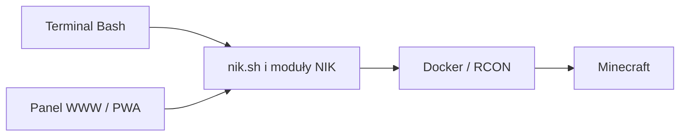

# NIK v2 — Naczelny Inspektorat Kreeperowy

**Dla Franka ♥ Tata**

NIK to przede wszystkim **modułowy projekt Bash z polskimi komendami do
Minecraft Java**. Obsługuje przedmioty, zaklęcia, efekty, teleporty, tryby gry,
zestawy, wiadomości i kopie świata. Terminal ma kolorowe listy i baner,
uzupełnianie Tab oraz podpowiedzi przy literówkach. Aktualna wersja: **2.7.0**.

Do projektu należy też **opcjonalny panel WWW/PWA NIK Mobile** — minecraftowa
nakładka na oryginalny `nik.sh`. **Dziecko lub gracz może wpisywać polskie
polecenia w terminalu albo wybierać te same czynności w panelu WWW**, również
na telefonie. Obie drogi korzystają z jednego NIK, tej samej konfiguracji
oraz jego walidacji i logiki komend.

| Sposób obsługi | Jak korzystać |
|---|---|
| Terminal Bash na serwerze | Po wczytaniu NIK wpisz np. `daj g1 diament 16`, `plecak g1` lub uruchom `nik menu`. |
| Panel WWW na komputerze lub telefonie | Zaloguj się, wybierz gracza, przedmiot albo akcję i naciśnij „Wykonaj”. |
| Aplikacja PWA | Zainstaluj panel z przeglądarki pod adresem HTTPS, aby mieć jego ikonę na telefonie. |



**Rozwijany jest NIK v2 w katalogu [`v2/`](v2/).** NIK v1 jest archiwalny,
bez dalszego rozwoju. Jego kod i dotychczasowa dokumentacja znajdują się
w [`archive/v1/`](archive/v1/). Archiwum zachowuje historyczny kod; instaluj v2.

## Co potrafi

| Funkcja | Przykład |
|---|---|
| Przedmioty i szukanie PL/EN | `daj g1 diament 64`, `szukaj jajo_` |
| Nowy zaklęty przedmiot | `encik g1 diamentowy_miecz ostrosc:5 naprawa` |
| Zaklinanie rzeczy w głównej ręce | `zaklnij g1 ostrosc:5 naprawa` |
| Pełne, kolorowe listy | `przedmioty`, `encik co`, `efekt co` |
| Efekty i leczenie | `efekt g1 sila 60 2`, `zdrowie g1` |
| Zapis miejsca z pozycji gracza | `punkt g1 baza`, później `tp g1 baza` |
| Podgląd plecaka | `plecak g1` |
| Duży napis w grze | `napis g1 "Brawo! ♥"` |
| Stworzenie obok gracza | `przywolaj g1 krowa`, `przywolaj co` |
| Pozycja i powrót po teleportacji NIK | `gdzie g1`, `powrot g1` |
| Prywatna wiadomość od Taty w grze | `tata g1 "Świetna budowla! ♥"` |
| Teleporty i miejsca | `dom g1`, `tp g1 gracz2`, `miejsce lista` |
| Tryb wskazanego gracza, ten sam świat | `kreatywny g1`, `przetrwanie g1`, `obserwator g1` |
| Własne zestawy | `zestaw zapisz wyprawa pochodnia=64 pieczona_wolowina=32` |
| Dawanie zapisanego zestawu | `zestaw g1 wyprawa` |
| Zapis bieżącego stanu | `zapiszswiat` |
| Oddzielne kopie świata | `kopia`, `kopia lista` |
| Przywracanie po kopii bieżącego świata | `przywroc ID_KOPII --potwierdz` |
| Stan graczy: online, zdrowie, tryb i pozycja | `nik stan`, `nik stan g1` |
| Diagnostyka | `nik status` |

Katalog dla Minecraft Java **26.3** obejmuje 1657 przedmiotów, 43 zaklęcia
z polskimi i angielskimi nazwami oraz 40 efektów. Starsze nazwy przedmiotów
pozostają aliasami. Dane i reguły pochodzą z rejestrów oraz tłumaczeń vanilla.
Niestandardowe datapacki mogą wymagać osobnych zmian.

## NIK Mobile — panel WWW i PWA

Panel jest dodatkowym interfejsem do bashowego NIK. Użytkownik może wybrać
przyciski zamiast pisać komendy; panel uruchamia oryginalny `nik.sh` na serwerze.
NIK odpowiada za interpretację poleceń, walidację graczy i przedmiotów,
komunikację z Minecraftem oraz tworzenie kopii świata. Terminal działa również
samodzielnie, bez uruchomionego panelu. Backend panelu używa Pythona 3.11+
i jego biblioteki standardowej, a widok korzysta z HTML, CSS i JavaScript.

W panelu znajdziesz:

- minecraftowy wygląd i prawdziwe, lokalne ikonki 1657 przedmiotów oraz 90 stworzeń;
- wybór gracza, wyszukiwarkę polskich i angielskich nazw, ilości i zaklęcia;
- ekwipunek, efekty, teleporty, tryby gry, zadania i kolorowe wiadomości od Taty;
- własne ulubione przyciski z zapamiętanym graczem i parametrami;
- historię ostatnich 100 działań z wynikami, filtrami gracza, komendy i daty;
- kolejkę ze stanami „Oczekuje”, „Wykonuje się” i „Zakończone”;
- karty graczy online: zdrowie, jedzenie, tryb, pozycję i szybkie akcje;
- datę ostatniej kopii świata i tworzenie nowej po potwierdzeniu przerwy w grze;
- podgląd bez zmian w grze oraz potwierdzenia ważniejszych operacji.

**Historia, wyniki i ulubione pozostają po odświeżeniu, ponownym logowaniu
i restarcie panelu.** Są zapisane prywatnie na własnym serwerze. Kliknij wpis
historii, aby ponownie otworzyć wynik; panel nie ponawia przez to komendy.

Panel działa jako usługa użytkownika systemd na porcie 6767. Prywatny HTTPS
z prawidłowym certyfikatem może zapewnić Tailscale Serve. Można również włączyć
lokalny dostęp HTTP po IP serwera. Instalacja PWA wymaga HTTPS; jej oprawa działa
z cache, a wykonywanie komend wymaga połączenia z serwerem. Polecenia nie są
odtwarzane offline. Dostęp chronią hasło, cookie sesji oraz CSRF.

Instalacja, konfiguracja, obsługa i sterowanie usługą:
[instrukcja panelu WWW/PWA](v2/panel/README.md).

## Stabilizacja 2.5.1

Ujednolicono obsługę błędów także w podstawieniach komend Bash, ograniczono
oczekiwanie na blokady oraz wymuszono zakończenie procesu transportu ignorującego
TERM. Parser, pomoc i rejestr komend mają osobne moduły. Log i jego blokada są
prywatne, a paczki powstają z jawnego manifestu plików i mają testy prywatności.
CI kontroluje dodatkowo śledzone prywatne ścieżki i kompletność manifestu.

Przywoływanie obsługuje opcjonalną ilość: `przywolaj g1 krowa` daje jedną,
`przywolaj g1 krowa 12` daje dwanaście (zakres 1–64). Błąd przerywa sekwencję;
wcześniej przywołane stworzenia pozostają. Bossy wymagają potwierdzenia.

Zasady utrzymania: [architektura](v2/ARCHITECTURE.md) i
[prywatność oraz bezpieczeństwo](v2/SECURITY.md).

## Nowe w 2.5 — kolorowe menu i zabawa

```bash
nik menu
prowadz g1 baza              # kierunek i odległość w grze, bez teleportu
odliczanie g1 10 "Start!"
losuj g1                     # własna lista wyzwań + książka od Taty
nagroda lista
nagroda g1 budowniczy
przepis pochodnia
```

Menu prowadzi przez wybór gracza, kategorii i czynności. Pokazuje komendę przed
wykonaniem i pozwala wybrać podgląd lub anulowanie. Prowadzenie odświeża pasek
co 2 sekundy przez domyślnie minutę; uwzględnia kierunek patrzenia, wymiar i wysokość,
ale nie wyszukuje bezpiecznej trasy. Receptury pochodzą z 2042 plików vanilla 26.3.
Własne wyzwania i nagrody zapisujesz w prywatnym `config/`; publiczna paczka ma
wyłącznie przykłady. Szczegóły i ograniczenia: [instrukcja v2](v2/README.md).

## Nowe w 2.4 — wygoda i wspólne przygody

```bash
ratunek g1                  # dom, leczenie i 30 s ochrony przed ogniem
napraw g1                   # trzymana rzecz, bez utraty nazwy i zaklęć
pogoda slonce 10m
efekt g1 sila 1h 2
punkt lista
punkt usun baza --potwierdz
ender g1
fajerwerki g1
zadanie g1 "Zbuduj latarnię przy porcie"
ochrona budowanie --potwierdz
```

Pomoc ma komendy pogrupowane tematycznie, minecraftowe ramki, zawijane opisy
i tęczowy podpis. Status, słowniki, ekwipunki i punkty mają wspólną oprawę.
Układ dopasowuje się także do wąskiego terminala, a opcje pozostają po polsku.

Ratunek wymaga zapisanego miejsca (`dom` lub podanej nazwy). Odporność zapobiega
obrażeniom od ognia; płomienie mogą pozostać widoczne do wygaśnięcia lub wejścia
do wody. Naprawa zmienia wyłącznie uszkodzenie przedmiotu. `ender` pokazuje
27 slotów, a czasy `s`, `m`, `h` działają przy pogodzie i efektach.

Fajerwerki są pokazem cząsteczek i dźwięku bez obrażeń. Zadanie trafia do gracza
jako książka **Zadanie od Taty**, do otwarcia w grze; dłuższe treści mają strony.
`zadanie g1 pokaz`, `ksiazka`, `gotowe` i `usun --potwierdz` zarządzają zapisem.
Wydane książki nie aktualizują się automatycznie.

Profil budowania zmienia cztery reguły świata: niszczenie przez moby i pociski,
wybuchy TNT oraz rozprzestrzenianie ognia. `ochrona status` pokazuje reguły,
a `ochrona wylacz --potwierdz` przywraca ich dokładne wartości sprzed zmiany.
Profil nie włącza się sam przy instalacji. Działa w całym świecie, więc wymaga
potwierdzenia. Zapisane zadania, miejsca i kopie reguł pozostają prywatne.
Szczegóły oraz ograniczenia opisuje [README v2](v2/README.md).

## Instalacja na serwerze

Wymagania: Linux, Bash 4.4+, Docker dostępny dla użytkownika, `rcon-cli` w
kontenerze Minecraft, GNU coreutils, `flock`, awk, sed, sort oraz Python 3.11+.
Kopie świata wymagają również Python 3.11+ w obrazie Minecraft i trwałego
wolumenu `/data`. Hasło RCON pozostaje w konfiguracji kontenera.
NIK nie wymaga wpisywania go do publicznych plików i nie łączy się sam przez SSH.

Pierwsza instalacja:

```bash
git clone https://github.com/franekfrk/nik.git
cd nik
mkdir -p "$HOME/.nik"
cp -R v2/. "$HOME/.nik/"
cp -R "$HOME/.nik/config.example/." "$HOME/.nik/config/"
chmod 700 "$HOME/.nik" "$HOME/.nik/config"
# Edytuj ~/.nik/config/config.env, players.tsv i places.tsv.
source "$HOME/.nik/nik.sh"
nik
```

Do `~/.bashrc` dodaj:

```bash
source "$HOME/.nik/nik.sh"
```

Po wczytaniu działają skróty `daj`, `d`, `encik`, `zaklnij`, `kreatywny`,
`zestaw`, `kopia`, `gdzie`, `powrot`, `tata`, `zapiszswiat` i pozostałe komendy oraz uzupełnianie Tab.
Używaj `source`, żeby dodać je do aktualnej sesji. Strict mode skryptu nie zmienia
ustawień powłoki użytkownika. Przy aktualizacji zachowaj dotychczasowe `config/`;
nie kopiuj ponownie przykładów na własne ustawienia.

## Opcje po polsku

```bash
nik --pomoc
nik zaklnij --pomoc
nik --wersja
zaklnij g1 ostrosc:5 --podglad
wyposaz g1 walka --potwierdz
nik --konfiguracja /sciezka/do/config status
```

`--podglad` pokazuje plan bez wykonywania operacji. `--potwierdz` jest wymagane
przy wybranych operacjach, m.in. przywracaniu świata, nadpisywaniu wyposażenia
czy restartowaniu. Klawisz Tab podpowiada polskie opcje. Angielskie opcje
`--config`, `--dry-run`, `--confirm`, `--help`, `--version` nadal działają jako aliasy.
Nazwy przedmiotów i zaklęć można podawać także z polskimi znakami.

## Gdzie, powrót i wiadomości od Taty

```bash
gdzie g1                            # X/Y/Z, wymiar i kierunek
dom g1                              # zapisuje pozycję sprzed teleportacji
powrot g1                           # wraca razem z wymiarem i kierunkiem
tata g1 "Franek, czas na kolację!"    # prywatny czat [Tata ♥]
wiadomosc g1 "Świetna robota!"       # odpowiednik tata
```

Powrót zapamiętuje ostatnią udaną teleportację przez `tp`, `dom`, `zamek` lub
`dolacz` i zużywa punkt po udanym powrocie. Nie śledzi śmierci, portali ani
teleportacji poza NIK. Punkty pozostają prywatne w `~/.nik/state/returns/`,
poza Gitem i paczkami ZIP. Gracz musi być online.

Wiadomość trafia wyłącznie do wskazanego gracza: złoty podpis **[Tata ♥]**
i biała treść, maksymalnie 512 znaków. Tekst nie uruchamia poleceń i nie
interpretuje selektorów. Te komendy również obsługują Tab i `--podglad`.

## Punkty, plecak, napisy i stworzenia

```bash
punkt g1 baza                 # pozycja i wymiar gracza → prywatne miejsce
tp g1 baza
plecak g1                     # sloty, polskie nazwy, ilości i zaklęcia
napis g1 "Brawo! ♥"           # złoty tytuł, podpis Od Taty ♥
przywolaj g1 krowa            # jedno stworzenie obok gracza
przywolaj co                  # 90 rodzajów stworzeń PL/EN
```

`punkt` zachowuje istniejące miejsca i odrzuca kolidujące nazwy. `plecak` tylko
odczytuje listę Inventory: pasek szybkiego wyboru i plecak; obsługuje też dawne
sloty wyposażenia, jeśli występują w odczycie. Nie odpytuje osobno wyposażenia
ani Ender Chest. `napis` trwa około 5,5 s przy 20 tickach/s i zastępuje bieżący
tytuł gracza. Treść jest zwykłym tekstem.

`przywolaj` tworzy stworzenie 2 bloki w kierunku +X od gracza, w jego wymiarze.
Wybierz miejsce z odpowiednią przestrzenią. Polskie nazwy i angielskie ID
działają równolegle; Tab podpowiada obie wersje. Smok i wither wymagają
`--potwierdz`, bo mogą niszczyć otoczenie. Wszystkie nowe komendy obsługują
`--podglad`, bez odpytywania gracza i wykonywania zmian. Nowe punkty są
prywatną konfiguracją i pozostają poza publicznym repozytorium.

## Zapis a kopia świata

`zapiszswiat` zapisuje bieżący stan gry. `kopia` tworzy osobne archiwum w
`~/.nik/world-backups/`, które można później przywrócić. **Tworzenie i przywracanie
kopii na krótko zatrzymuje kontener i rozłącza graczy.** Przywracanie najpierw
zachowuje bieżący świat. Archiwum i sumy SHA256 są sprawdzane przed zmianami;
kontener uruchamia się ponownie, jeśli działał przed operacją. Gotowość gry
sprawdź przez `nik status`.

Kopia obejmuje świat, dane graczy w świecie i jego wymiary. Nie obejmuje
konfiguracji serwera, pluginów ani zewnętrznych baz. Kopii nie usuwa się
automatycznie. Szczegóły, wymagania i granice odzyskiwania opisuje
[dokumentacja v2](v2/README.md).

## Dane prywatne i paczki

Repozytorium zawiera przykłady `PlayerOne` i `PlayerTwo`. Własna konfiguracja,
logi, oryginalny prywatny skrypt, archiwa światów oraz gotowe prywatne ZIP-y
są wykluczone z Gita. `.gitignore` nie usuwa sekretów wcześniej zapisanych
w historii — sprawdzaj pliki przed publikowaniem.

```bash
python3 v2/tools/package.py --out dist
# Opcjonalnie, wyłącznie do prywatnego przechowania:
python3 v2/tools/package.py --out dist --private-config "$HOME/.nik/config"
```

Paczka publiczna zawiera kod i przykłady. Paczka prywatna zawiera dodatkowo
wskazane ustawienia. **Nie publikuj paczki prywatnej.** Sumy plików zapisują się
w `dist/SHA256SUMS`.

## Testy i architektura

```bash
# Narzędzia kontroli: ShellCheck, Bats, Python 3.11+.
bash v2/tests/check.sh
```

Moduły Bash znajdują się w `v2/lib/`, katalogi i reguły w `v2/data/`, a narzędzia
w `v2/tools/`. CI sprawdza składnię Bash, ShellCheck, integralność danych,
testy komend z modelem Docker/RCON oraz izolowane testy kopii i przywracania.
Testy nie korzystają z produkcyjnego świata ani prywatnych ustawień.

Pełne użycie: [README v2](v2/README.md). Zakres kontroli i ograniczenia:
[VALIDATION.md](v2/VALIDATION.md).
